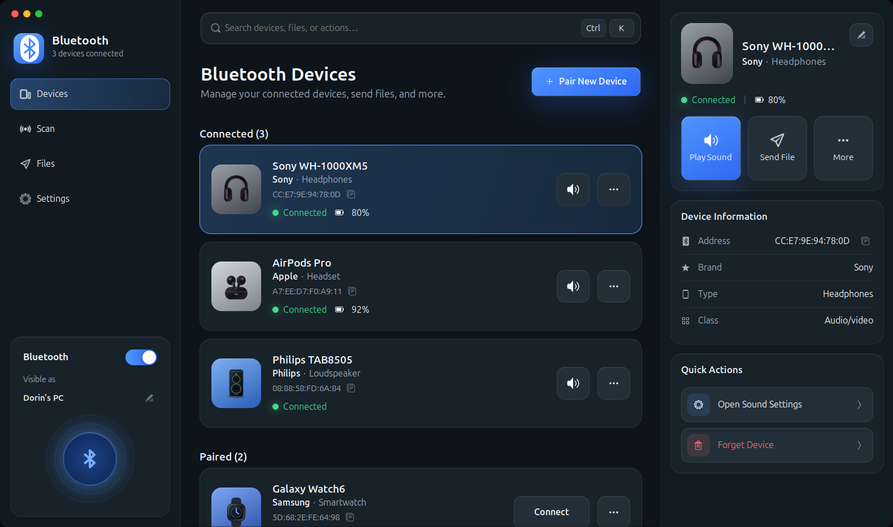
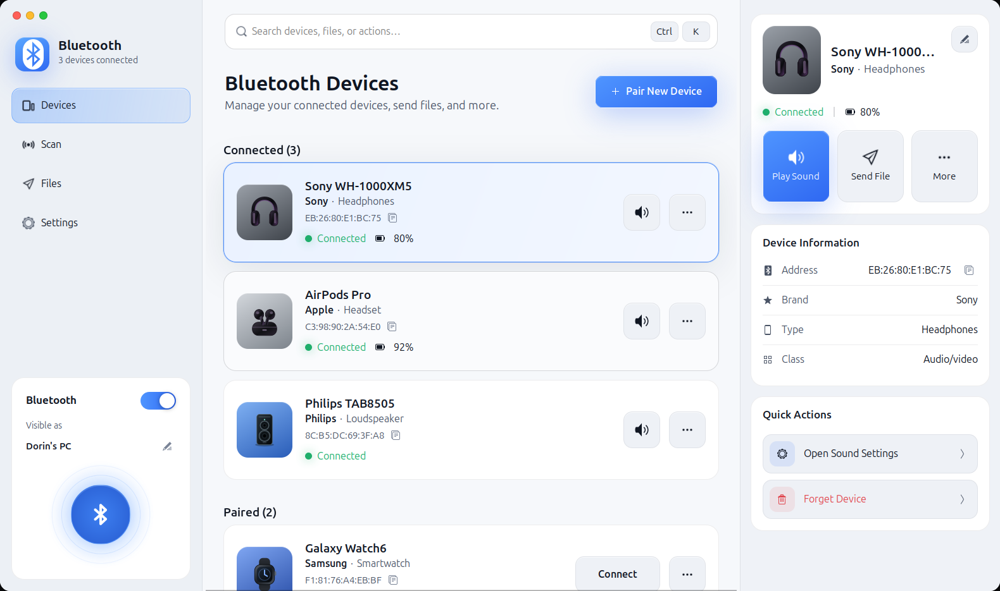
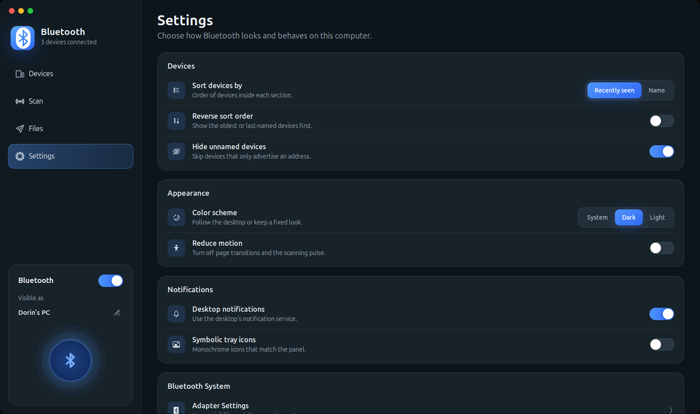

# Blueman Next

A modern redesign of [Blueman](https://github.com/blueman-project/blueman), the GTK Bluetooth manager. It keeps
Blueman's BlueZ backend and plugins, and puts a new GTK 3 interface on top.



| Light theme | Settings |
| --- | --- |
|  |  |

<sub>Screenshots use mocked devices with random addresses.</sub>

## What's new

* **Three-panel layout**: sidebar, device dashboard and a details panel for the selected device, in a borderless
  window with macOS-style window buttons.
* **Device cards** grouped into Connected, Paired and Available, with the actions that fit each state: sound settings
  for connected audio devices, Connect, Pair, and a "…" menu that keeps all plugin actions.
* **Known brands**: Sony, Apple, Samsung, Philips, JBL, Bose and 18 more are recognised from the device name or
  its Bluetooth manufacturer ID, and shown with a brand label and colour. Earbuds, headphones, speakers and watches
  get their own artwork.
* **Real data only**: battery levels appear only when the device reports them, and no values are invented.
* **Details panel** with Play Sound, Send File, address copy, type and class, plus quick actions.
* **Settings as a page** inside the window, with smooth page transitions and a *Reduce motion* option.
* **Dark and light themes** that follow the desktop or a fixed choice, and a layout that adapts down to small
  windows.
* Search with <kbd>Ctrl</kbd>+<kbd>K</kbd>; Settings with <kbd>Ctrl</kbd>+<kbd>,</kbd>.

## Try it without installing

```sh
./blueman-next              # installs missing build dependencies (Debian/Ubuntu), builds, and runs
./blueman-next --no-deps    # skip the dependency check on other distributions
```

This builds into `build-local/` and never replaces the Blueman installed by your distribution. See
[docs/LOCAL_BUILD.md](docs/LOCAL_BUILD.md) for details.

## Description

Blueman is a GTK+ Bluetooth Manager

Blueman is designed to provide a simple yet effective means for
controlling the BlueZ API and simplifying Bluetooth tasks, such as:

* Connecting to dial-up networks
* Connecting to / Creating Bluetooth networks
* Connecting to input devices
* Connecting to audio devices
* Sending / Receiving files via OBEX
* Pairing

It is lightweight, easy to use, Python based, and GPL licensed.

## Installing

See [Dependencies.md](Dependencies.md) for a list of build and runtime dependencies.

To install a packaged release of blueman, run `./configure && make && make install`.

To generate and run a configure script from source, run `./autogen.sh`.

If you are packaging it for your distribution, please make sure to pass `--disable-schemas-compile` and run `glib-compile-schemas /datadir/glib-2.0/schemas` as part of your (un)install phase.

[](https://repology.org/project/blueman/versions)

## Support / Troubleshooting

If you're reporting a bug, please read the [Troubleshooting page](https://github.com/blueman-project/blueman/wiki/Troubleshooting) to provide all relevant info.

Feel free to [open a GitHub issue](https://github.com/blueman-project/blueman/issues/new) to file bugs, or ask about anything you need help with.

## Contributing

Fork, make your changes, and issue a pull request. If you just want to edit a single file, GitHub will guide you through that process.

### Translate

Translations are managed on Hosted Weblate.

[](https://hosted.weblate.org/engage/blueman/)

## License

All parts of the software are licensed under GPLv3 (or GPLv2) and allow redistribution under any later version.
